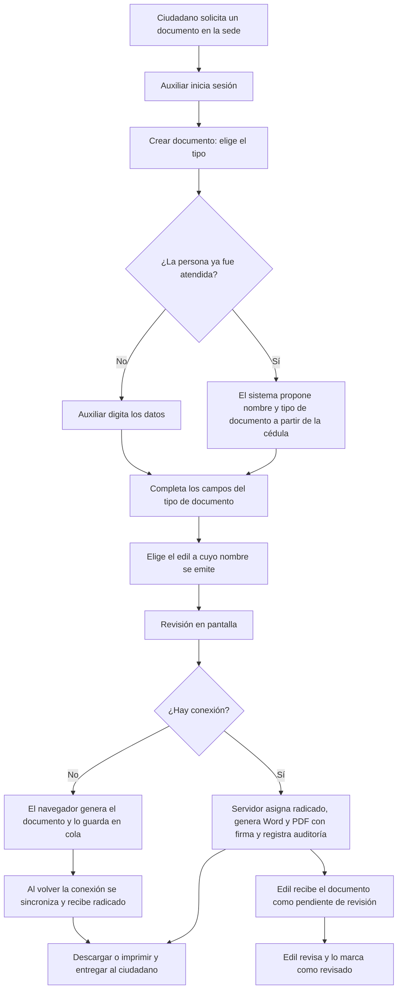
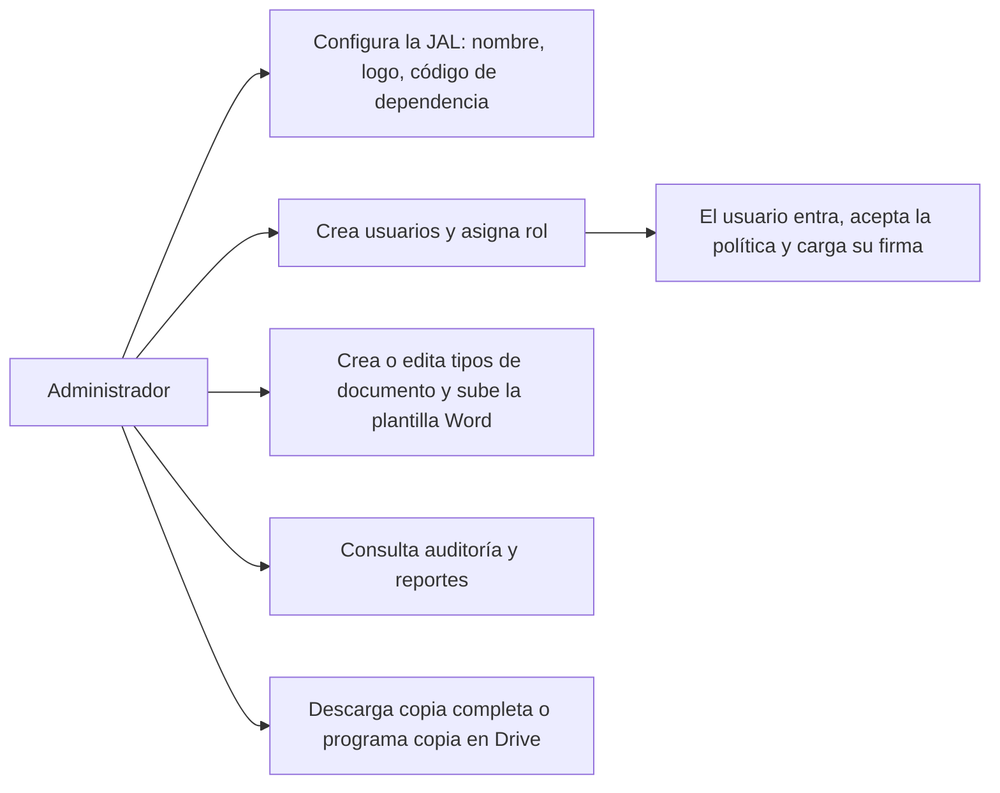

# Procesos, historias de usuario y casos de uso

Describe el comportamiento **implementado**. Donde el proceso real de la JAL puede diferir (por ejemplo, quién firma), se marca como [Supuesto] para validar con la JAL.

## 1. Proceso principal: emitir un documento



**Excepciones**

| Situación | Comportamiento |
|---|---|
| Campo obligatorio vacío o con formato inválido | Mensaje junto al campo y resumen sobre el botón; no se envía |
| El edil (o el firmante) no tiene firma cargada | No se genera: el sistema pide registrar la firma en el perfil (`documentService.js`) |
| No hay LibreOffice ni Word para convertir a PDF | Se usa un PDF de respaldo hecho con mammoth y pdf-lib, que **pierde el diseño** de la plantilla (`documentGeneratorService.js`) |
| Sin conexión y sesión vencida | Se conserva la cola local; pide iniciar sesión al volver la red |
| Dos personas generan a la vez | El consecutivo se reserva de forma atómica dentro de la transacción; no hay duplicados ni huecos |

> **Pendiente de confirmar con la JAL** [Supuesto]: en el modo sin conexión el documento entregado puede no llevar aún el radicado definitivo. Debe acordarse si se permite entregar documentos antes de sincronizar.

## 2. Proceso de administración



## 3. Actores y permisos

| Actor | Puede | No puede |
|---|---|---|
| Auxiliar | Crear documentos, ver y descargar los suyos, buscar personas atendidas, perfil y firma | Ver documentos de otros, usuarios, auditoría, reportes, configuración |
| Edil | Lo del auxiliar, más ver todos los documentos de la JAL, revisarlos, reportes, auditoría, resumen | Crear usuarios, cambiar tipos de documento, configurar la JAL, copias |
| Administrador | Todo dentro de su JAL | Ver o modificar otra JAL |
| Ciudadano | No usa el sistema | — |

## 4. Historias de usuario

| ID | Historia | Criterios de aceptación | Requisito |
|---|---|---|---|
| HU-01 | Como **auxiliar**, quiero generar un certificado en pocos pasos para atender rápido a quien lo solicita | Tres pasos (Datos, Revisión, Listo); obtengo Word y PDF con radicado | RF-10, RF-13 |
| HU-02 | Como **auxiliar**, quiero que el sistema recuerde los datos de una persona ya atendida para no volver a escribirlos | Al digitar la cédula se completan nombre y tipo de documento | RF-14 |
| HU-03 | Como **auxiliar**, quiero emitir a nombre de un edil con su firma | Elijo el edil; su firma aparece en el documento | RF-11, RF-12 |
| HU-04 | Como **auxiliar**, quiero seguir trabajando si se cae internet | El documento se genera y se sincroniza después | RF-23 |
| HU-05 | Como **edil**, quiero ver lo emitido a mi nombre y marcarlo como revisado | Lista con filtro de pendientes; botón revisar | RF-16, RF-17 |
| HU-06 | Como **edil**, quiero reportes para rendir cuentas | Cifras por tipo y período; descarga en Excel | RF-19 |
| HU-07 | Como **administrador**, quiero crear usuarios con su rol para controlar el acceso | Crear, editar, desactivar; solo yo puedo hacerlo | RF-06, RF-07 |
| HU-08 | Como **administrador**, quiero agregar un tipo de documento nuevo sin programar | Defino campos, subo la plantilla y aparece en Crear | RF-08, RF-09 |
| HU-09 | Como **administrador**, quiero saber quién hizo qué | Auditoría con filtros por usuario, acción y fecha | RF-20 |
| HU-10 | Como **administrador**, quiero una copia completa de los datos | Descargo un zip o programo la copia en Drive | RD-02, RR-03 |
| HU-11 | Como **responsable técnico**, quiero restaurar una copia si algo falla | Script de restauración que avisa si no se aplicó | RR-02 |
| HU-12 | Como **Subsecretaría**, quiero instalar el sistema en otra JAL sin mezclar datos | Procedimiento y prueba de aislamiento | RM-03, RS-07 |
| HU-13 | Como **persona mayor o con poca experiencia digital**, quiero textos grandes y pasos claros | Letra base de 17 px, botones grandes, un paso a la vez | RA-01, RA-02 |
| HU-14 | Como **ciudadano**, quiero saber para qué se usan mis datos | Recibo el aviso de privacidad | RP-01 (pendiente) |

## 5. Casos de uso principales

### CU-01 Generar documento
- **Actor:** auxiliar (también edil y administrador).
- **Precondición:** sesión iniciada y política aceptada; existe al menos un tipo de documento activo.
- **Flujo:** 1) Abrir *Crear documento*. 2) Elegir tipo. 3) Digitar o recuperar los datos de la persona. 4) Completar los campos. 5) Elegir edil. 6) Revisar. 7) Confirmar. 8) Descargar.
- **Postcondición:** documento con radicado, Word y PDF guardados en la base de datos; registro `document.create` en auditoría; notificación al edil si se emitió a su nombre; copia a Drive y al receptor local solo si están configurados.
- **Alternos:** sin conexión (cola local y `document.sync_create` al sincronizar); error de validación (vuelve al paso 4).

### CU-02 Revisar documento
- **Actor:** edil. **Flujo:** abrir *Documentos de la JAL*, filtrar pendientes, abrir el detalle, marcar revisado. **Postcondición:** `reviewed`, `reviewed_at`, `reviewed_by` y auditoría `document.review`.

### CU-03 Gestionar usuario
- **Actor:** administrador. **Flujo:** *Usuarios* → *Nuevo usuario* → nombre, correo, rol, contraseña inicial → guardar. **Excepción:** correo ya registrado (el correo es único en toda la base de datos, no por JAL).

### CU-04 Configurar tipo de documento
- **Actor:** administrador. **Flujo:** *Tipos de documento* → nuevo → nombre, tipo de trámite (entrada, salida, interno), campos → subir `.docx` con variables `{campo}` → guardar. **Excepción:** archivo no válido (se rechaza por tipo y contenido).

### CU-05 Respaldar y restaurar
- **Actor:** administrador (zip desde el panel) o responsable técnico (scripts). **Flujo y límites:** ver [Respaldo y restauración](../07_OPERACION/RESPALDO_Y_RESTAURACION.md).

```mermaid
sequenceDiagram
    actor Aux as Auxiliar
    participant FE as Navegador (PWA)
    participant API as Backend
    participant DB as PostgreSQL
    Aux->>FE: Confirmar documento
    FE->>API: POST /v1/documents (cookie + X-CSRF-Token)
    API->>DB: BEGIN; reservar consecutivo (radicado_counters)
    API->>API: Llenar plantilla, insertar firma, convertir a PDF
    API->>DB: INSERT documents (Word y PDF); audit_logs; notifications; COMMIT
    API-->>FE: 201 con radicado
    FE->>API: GET /v1/documents/:id/download
    API-->>FE: Archivo
```
