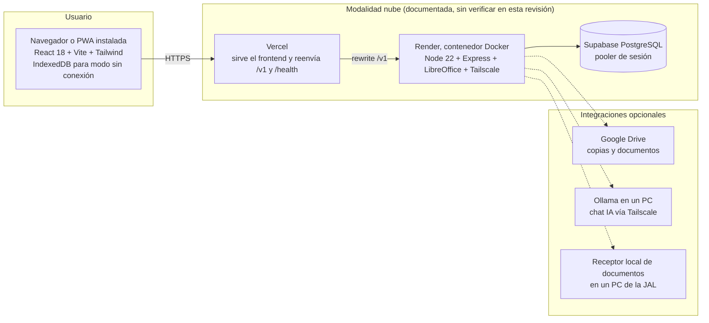

# Arquitectura general

Describe la arquitectura **tal como está en el código** (rama `main`, commit `91a14ac`). Las decisiones y sus alternativas están en [Decisiones arquitectónicas](DECISIONES_ARQUITECTONICAS.md).

## 1. Componentes



| Componente | Tecnología | Ubicación en el repositorio |
|---|---|---|
| Interfaz | React 18, React Router 7, Zustand, Tailwind, Workbox (PWA), IndexedDB (`idb`) | `frontend/` |
| API | Node.js ≥ 20, Express 4.22, Joi, helmet, express-rate-limit, multer, jsonwebtoken, speakeasy | `backend/src/` |
| Acceso a datos | Sequelize 6.37 con migraciones `sequelize-cli` | `backend/src/models/`, `backend/migrations/` |
| Generación de documentos | docxtemplater + PizZip + módulo de imagen; PDF con LibreOffice (Linux), Word COM (Windows) o, como último recurso, mammoth + pdf-lib | `backend/src/services/documentGeneratorService.js`, `libreOfficeConverter.js`, `wordConverter.js` |
| Generación sin conexión | Mismo motor de plantillas en el navegador | `frontend/src/services/clientDocumentGenerator.js` |
| Operación local (Windows) | Scripts `.bat` + `gestor.py` + `scripts/*.py`, túnel ngrok | raíz y `scripts/` |
| Contenedores | Docker Compose con nginx, backend y PostgreSQL | `deploy/` |
| Nube | `render.yaml`, `deploy/render/`, `frontend/vercel.json` | raíz, `deploy/render/`, `frontend/` |

Capas del backend: **rutas** (`routes/`, validación Joi y permisos) → **controladores** (`controllers/`) → **servicios** (`services/`, lógica de negocio) → **modelos** (`models/`). Middleware común: `requestId`, métricas Prometheus, helmet, CORS, límite de peticiones, `sanitize`, `authenticate`, `authorize`, `validate`, `errorHandler`.

## 2. Modalidades de despliegue

| Modalidad | Para qué | Estado en esta revisión |
|---|---|---|
| Nube: Vercel + Render + Supabase | Uso diario desde cualquier lugar | Documentada en `docs/DESPLIEGUE_HIBRIDO.md`; **producción no verificada** (sin acceso); `render.yaml` corregido |
| Docker Compose (`deploy/`) | Servidor propio de la entidad | Corregida (faltaban claves); **no probada** (sin Docker en el entorno) |
| Windows local (`iniciar.bat`, ngrok) | PC de la sede o del desarrollador | Documentada; no probada en esta revisión |
| Local de desarrollo (Linux) | Pruebas | **Verificada** (modo producción, humo 38/39) |

> Las modalidades local y nube usan **bases de datos distintas** que no se sincronizan entre sí. La JAL debe usar una sola como fuente oficial.

## 3. Flujo de autenticación

```mermaid
sequenceDiagram
    participant FE as Navegador
    participant API as Backend
    participant DB as PostgreSQL
    FE->>API: POST /v1/auth/login (correo, contraseña)
    API->>DB: Buscar usuario activo; comparar bcrypt; contar intentos
    alt TOTP activo
      API-->>FE: Pide código de 6 dígitos
      FE->>API: POST /v1/auth/2fa/validate
    end
    API-->>FE: Cookies httpOnly access_token (8 h) y refresh_token (30 d, solo /v1/auth/refresh) + cookie csrf_token
    FE->>API: Peticiones con cookie y cabecera X-CSRF-Token
    API->>API: authenticate: verifica firma RS256, tokens_invalid_before, usuario activo, CSRF
    FE->>API: POST /v1/auth/refresh al vencer
```

- En producción la firma es RS256 con `JWT_PRIVATE_KEY`/`JWT_PUBLIC_KEY`; en desarrollo HS256 con `JWT_SECRET`.
- "Cerrar todas las sesiones" y el cambio de contraseña actualizan `tokens_invalid_before`, lo que invalida los tokens anteriores.
- La aceptación de la política se registra en `consent_accepted_at`; la redirección a `/habeas-data` la hace el frontend.

## 4. Flujo de un documento

1. El frontend envía datos y, si aplica, la firma a `POST /v1/documents`.
2. El servicio valida el tipo y los campos, resuelve la firma (subida, del edil elegido o del firmante; si no hay ninguna, rechaza).
3. Dentro de una transacción: reserva el consecutivo en `radicado_counters`, llena la plantilla, convierte a PDF y guarda Word y PDF en `documents` (BYTEA).
4. Registra auditoría y, si se emitió a nombre de un edil, una notificación.
5. Fuera de la transacción y solo si están configurados: copia a Google Drive y al receptor local.

Sin conexión: el navegador genera el documento con `clientDocumentGenerator`, lo guarda en IndexedDB y lo envía a `POST /v1/sync/batch` al volver la red; el servidor le asigna radicado.

## 5. Manejo de errores y registros

- Respuesta de error uniforme: `{ error, code, message, requestId }`. En producción los errores 5xx no exponen el detalle interno (`middleware/errorHandler.js`).
- Cada petición lleva un identificador (`X-Request-Id`) que aparece en el registro.
- Registros: JSON por salida estándar en producción (`config/logger.js`); los recoge la plataforma (Render) o Docker. **No hay** centralización ni retención definida de registros.
- Métricas Prometheus en `/metrics`, protegidas con `METRICS_TOKEN` en producción.
- Salud: `GET /health` comprueba la base de datos.
- Auditoría funcional: tabla `audit_logs` (ver [Modelo de datos](MODELO_DE_DATOS.md)).

## 6. Límites conocidos de la arquitectura

- Los archivos de los documentos se guardan dentro de PostgreSQL. Simplifica las copias, pero hace crecer la base de datos; con planes gratuitos de Supabase el espacio es limitado [Supuesto: depende del plan].
- La conversión fiel a PDF necesita LibreOffice en el servidor (incluido en la imagen de Render y Docker).
- Un solo proceso de backend; no se probó con varias instancias.
- El aislamiento entre JAL lo hace la aplicación filtrando por `jal_id`; la base de datos no lo impone (RLS está activado sin políticas y el backend se conecta como dueño de las tablas). Ver [Estrategia multi-JAL](../08_REPLICACION/ESTRATEGIA_MULTIJAL.md).
