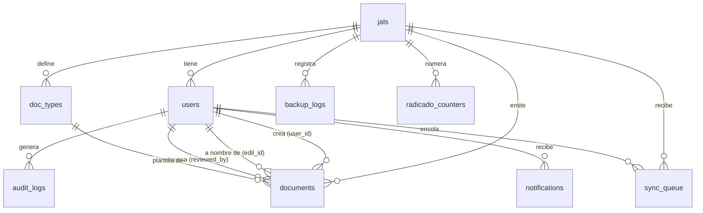

# Modelo de datos

Extraído de una base de datos PostgreSQL 16 creada desde cero con las 26 migraciones de `backend/migrations/` (29-10-2026). Todas las claves primarias son UUID salvo `radicado_counters`.

## 1. Diagrama entidad-relación

## 2. Diccionario de datos

**Datos personales:** 🟠 de ciudadanos · 🔵 de usuarios internos · 🔒 secreto o credencial.

### `jals`: cada Junta Administradora Local
| Campo | Tipo | Nota |
|---|---|---|
| id | uuid | |
| name | varchar | Nombre que aparece en la interfaz y documentos |
| logo_path, logo_url | varchar | Logo |
| config | jsonb | Entre otros `codigo_dependencia` (radicado) y la configuración de copias en Drive, con los tokens OAuth cifrados 🔒 |
| features | jsonb | Funciones activables por JAL |

### `users`
| Campo | Tipo | Nota |
|---|---|---|
| jal_id | uuid | JAL a la que pertenece |
| name 🔵, email 🔵 | varchar | El correo es **único en toda la base**, no por JAL |
| role | enum | `administrador`, `edil`, `auxiliar` |
| password_hash 🔒 | varchar | bcrypt, costo 12 |
| active, failed_attempts, locked_until | | Bloqueo por intentos |
| tokens_invalid_before | timestamptz | Invalida sesiones anteriores |
| cargo_titulo 🔵 | varchar | Cargo que aparece en los documentos |
| signature_path, signature_data 🔵 | varchar, text | Firma escaneada (imagen en base64) |
| totp_secret 🔒, totp_enabled | varchar, bool | Secreto TOTP **en claro** (brecha RS-12) |
| consent_accepted_at | timestamptz | Aceptación de la política |
| deleted_at | timestamptz | Borrado lógico |

### `doc_types`: tipos de documento
| Campo | Tipo | Nota |
|---|---|---|
| jal_id | uuid | |
| name | varchar | |
| fields | jsonb | Lista de campos (nombre, etiqueta, tipo, obligatorio, opciones) |
| template_path, template_data | varchar, text | Plantilla `.docx` (ruta o contenido) |
| tipo_tramite | enum | `entrada`, `salida`, `interno` → ENT, SAL, INT en el radicado |
| active, deleted_at | | |

### `documents`: documentos emitidos
| Campo | Tipo | Nota |
|---|---|---|
| jal_id, user_id, edil_id, doc_type_id | uuid | |
| doc_type_name | varchar | Copia del nombre del tipo al emitir |
| beneficiary_name 🟠, beneficiary_id 🟠 | varchar | Nombre y número de documento de la persona |
| metadata 🟠 | jsonb | Todos los campos digitados (puede incluir dirección, teléfono, correo, barrio, etc., según la plantilla) |
| numero_radicado | varchar | **Único en toda la base** (ver MJ-02) |
| document_number | varchar | Único por JAL |
| file_docx, file_pdf | bytea | Archivos generados |
| file_path_docx, file_path_pdf | varchar | Rutas en disco (modalidad local) |
| sync_status | enum | Estado de sincronización |
| reviewed, reviewed_at, reviewed_by | | Revisión del edil |
| tipo_tramite | enum | |
| deleted_at | timestamptz | Borrado lógico |

### `audit_logs`
| Campo | Tipo | Nota |
|---|---|---|
| timestamp, user_id, jal_id | | |
| action | varchar | p. ej. `auth.login`, `document.create`, `user.update`, `backup.export` |
| resource | varchar | Recurso afectado |
| result | enum | Éxito o fallo |
| ip 🔵 | varchar | |
| metadata | jsonb | Detalle de la acción |

### Otras tablas
| Tabla | Propósito |
|---|---|
| `notifications` | Avisos internos por usuario (`type`, `message`, `read`). El mensaje puede incluir el nombre del beneficiario 🟠 |
| `sync_queue` | Operaciones recibidas del modo sin conexión (`operation`, `payload` 🟠, `retries`, `error_message`) |
| `backup_logs` | Historial de copias (archivo, enlace en Drive, tamaño, estado, manual/automática) |
| `radicado_counters` | Último consecutivo por (`jal_id`, `year`, `tipo_tramite`) |
| `SequelizeMeta` | Migraciones aplicadas |

## 3. Índices y restricciones relevantes

| Índice | Efecto |
|---|---|
| `users_email_key` / `idx_users_email` (único) | Un correo no puede repetirse en dos JAL de la misma base. Hay dos índices equivalentes (redundancia menor) |
| `idx_documents_numero_radicado_unique` (único, global) | Si dos JAL comparten código de dependencia, el segundo radicado igual **falla** (MJ-02) |
| `idx_documents_jal_number` (único por JAL, parcial) | Consecutivo interno por JAL |
| `radicado_counters_pkey` (`jal_id`, `year`, `tipo_tramite`) | Consecutivo atómico con `INSERT … ON CONFLICT` |
| Índices de rendimiento (migración 17) | Consultas por JAL, fecha y usuario |

## 4. Seguridad a nivel de base de datos

La migración 26 activa **RLS sin políticas** en todas las tablas. Su propósito es cerrar la API REST pública de Supabase a los roles `anon` y `authenticated`. **No** separa datos entre JAL: el backend se conecta como dueño de las tablas y el dueño no está sujeto a RLS.

## 5. Migraciones

26 migraciones, todas con `down`. Probadas subiendo las 26, bajándolas todas y subiéndolas de nuevo sin error ([migraciones.txt](../11_CALIDAD/evidencias/2026-10-29/migraciones.txt)). **Advertencia:** bajar migraciones en una base con datos borra columnas y tablas; solo debe hacerse con respaldo previo y en un entorno de prueba.
